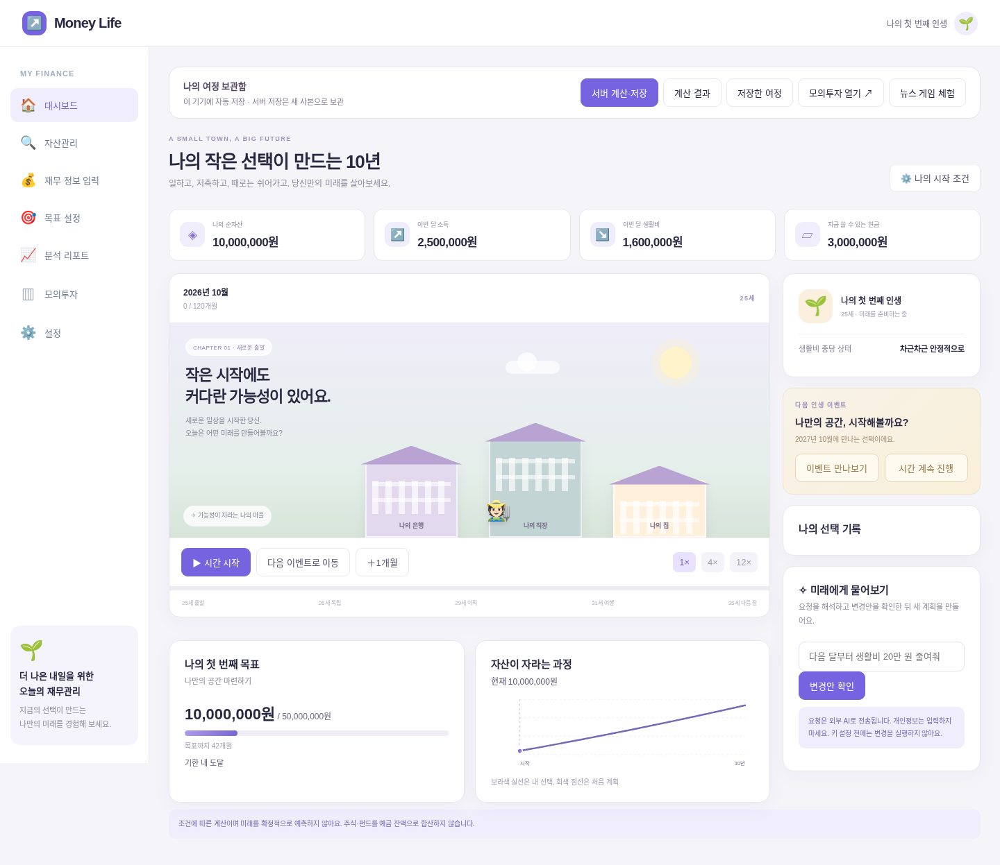
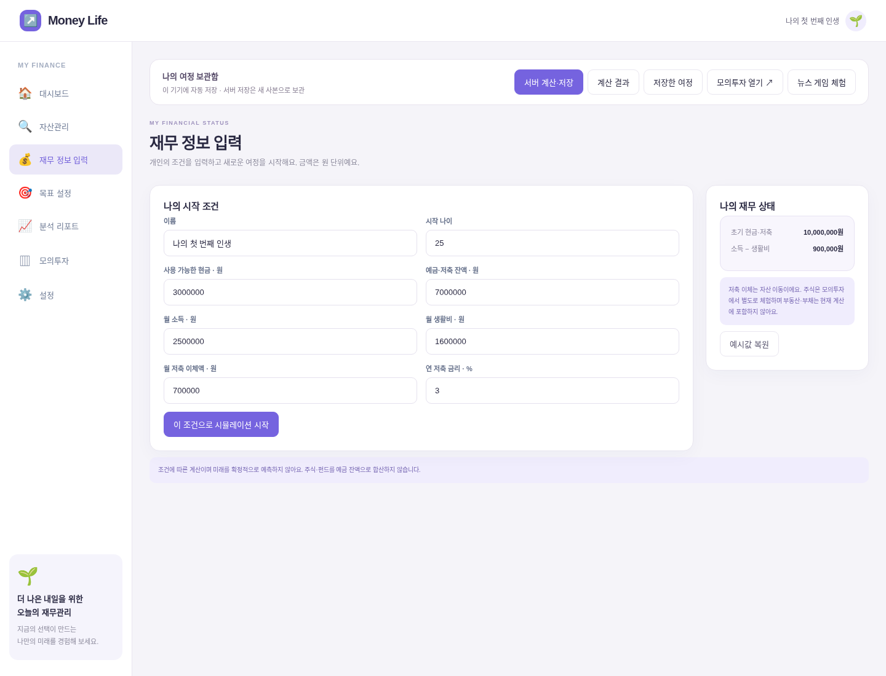

# 프론트·LLM·주가 자료 통합 · 2026-11-22

## 화면과 상태

예빈 브랜치 `1ce5db8`의 메뉴·대시보드·마을·목표·리포트 레이아웃을 Client에 이식했다. 원본 디자인 작업은 해당 브랜치에 보존한다. prototype은 참고본으로 고정하고 신규 기능의 실행 진입점은 Client/index.html이다. 화면 프레임워크를 추가하지 않았다.

재무 입력은 현금·예금/저축·소득·생활비·월 저축·금리로 제한한다. 주식/펀드를 저축으로 환산하지 않고, 부동산·부채를 미지원 계산에 포함하지 않는다. 주식 주문과 평가·뉴스 게임은 모의투자 메뉴에서 별도 사본으로 실행한다.

기존 money-life-v1 저장 자료와 MoneyLifePlanState 원 단위 변환 계약을 유지한다. 이름/나이/현금/저축/소득/지출/목표 및 월별 변경은 하나의 활성 상태에서 읽고 Engine/src/index.js로 미리 계산한다. 서버 저장 결과는 기존 원 단위 반올림 정책을 따른다. 예빈 브랜치의 별도 prototype/engine.js는 Client에서 가져오지 않는다.

휴식 이벤트는 적용할 각 월의 유효 소득을 0으로 만드는 3개월 변경이다. 소득 공백 비교는 각 월 소득에서 최대 100만원만 줄여 음수 소득을 만들지 않는다. 이벤트 확정은 /event-branches로 선택 전 원본·선택 후 계획·계산 결과를 일괄 저장한 뒤 화면에 반영한다. 서버 연결이 필요하며 실패하면 로컬 선택을 바꾸지 않는다. 일반 수동 저장은 별도 새 사본 저장이다.

## LLM 보충 답변과 설명

parse-change의 선택적 clarificationId로 원래 요청·질문·답변을 같은 Plan에 묶는다. 서버는 소유권·계획 일치·30분 만료·최대 세 보충 답변을 검증한다. 추가 답변은 모델의 user 데이터 문맥으로만 전달한다. ready 결과도 사용자가 승인해야 새 Plan/Run을 만든다.

일반 비교 설명은 metric-facts-v2로 바꿨다. 목표·자산 차이·부족 기간·가정 문장을 서버에서 작성하고, 모델은 네 사실 ID의 순서만 선택한다. 누락/중복/직접 문장 출력은 재요청 후 정형 설명으로 대체한다. 과거 버전 설명 캐시는 그대로 반환하지 않는다. source=llm은 문장 생성이 아니라 이 순서 선택에 모델이 참여했다는 의미이며 화면에서도 이를 명시한다.

AI 적용 요청 전후에 상태를 비교한다. 응답을 기다리는 동안 사용자의 조건이 바뀌면 새 서버 결과를 현재 화면에 덮어쓰지 않는다. 그 결과는 저장 목록에서 확인할 수 있다.

## 실제 주가 시연 준비

fixtures/market-demo-spec.json은 삼성전자 005930, 2024-01~2024-12의 수집 규격이다. 실제 가격 데이터 파일이 아니다. 등록 자료가 없을 때 화면은 가상 가격임을 표시한다.

가상 응답·로컬 회귀 검증과 실제 제공자 검증을 구분한다. 현재 작업 환경에 토스 인증정보가 없어 실제 수집을 수행하지 않았다. 외부 LLM 성능 실험도 수행하지 않았다. 모델/주가 연결이 준비됐다고 정확도나 실제 연동 성공을 주장하지 않는다.

## 화면

